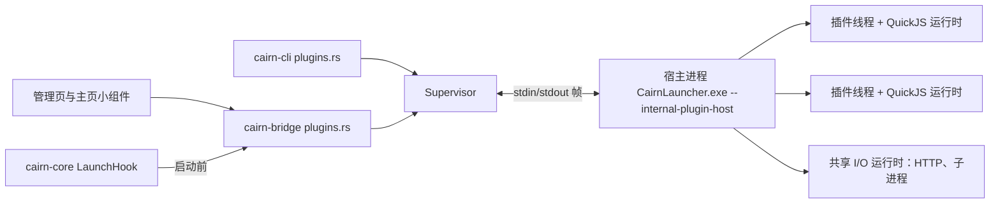

# Cairn 脚本插件技术规范

适用于插件 API 1。本文描述已实现的行为；修改接口时必须同步更新本文、[示例](examples)和测试。使用入门见 [README](README.md)。

## 1. 结构



- `cairn-plugin` 不依赖 core、bridge 或界面。它提供清单解析、协议、宿主和监督器，由 bridge（桌面）和 cli（命令行）各自把宿主请求映射到启动器操作。
- 宿主就是启动器自身的可执行文件，以 `--internal-plugin-host` 参数启动，不弹窗口，在创建界面、读取账户之前进入宿主模式。
- 所有脚本插件共享一个宿主进程。每个插件独占一个线程、一个 QuickJS `Runtime` 和 `Context`，插件之间不共享 JS 堆。HTTP 与子进程操作在宿主内一个 2 线程的 Tokio 运行时上执行，首次使用时才创建。
- 没有可运行的脚本插件时不创建宿主进程。只含小组件、没有 `main` 的插件不需要宿主。

## 2. 插件包

插件位于 `<数据目录>/plugins/<文件夹>/`，入口为 `plugin.json`（上限 256 KiB）：

| 字段 | 说明 |
| --- | --- |
| `id` | 必填。1–64 个小写字母、数字、`.`、`_`、`-`，以字母或数字开头。决定数据目录和小组件 kind，发布后不应修改 |
| `name`、`version` | 必填。名称 1–128 字符，版本 1–64 字符（不要求 SemVer） |
| `api` | 必填，当前为 `1`，不匹配时拒绝加载 |
| `main` | 入口模块，包内相对路径。省略表示纯声明式插件 |
| `permissions` | 申请的权限，见第 4 节。未知权限使清单无效 |
| `widgets` | 小组件，格式与 YAML 小组件相同（`id`、`name`、`summary`、`icon`、`size`、`sizes`、`min`、`max`、`heading`、`view`），按 YAML 规则校验 |
| `panels` | 面板页列表，格式同无 tabs 的 YAML 面板（`id`、`title`、`icon`、`view`），按 YAML 规则校验。面板不进 dock，由小组件动作或 `cairn.panels.open` 打开 |
| `commands` | `[{ "id", "title" }]`，需要 `main` |
| `settings` | 用户可改的设置，见下表；管理页的“设置”标签用原生控件显示 |
| `description`、`author`、`homepage` | 可选，显示在管理页 |

清单拒绝未知字段。小组件和命令的局部 ID 为 1–64 个小写字母、数字、`_`、`-`，以字母开头。两个文件夹使用同一插件 ID 时两者都不加载，并显示冲突。

插件小组件在主页布局中的 kind 为 `plugin:<插件 id>/<小组件 id>`。插件停用、损坏或被删除时，主页保留其位置和选项，显示占位并提供管理入口。

模块：入口和其他文件都按包内路径加载。只允许 `./`、`../` 开头的相对导入，不能离开包目录；`.json` 文件作为 `export default` 导入。单个模块上限 4 MiB。不支持 npm 包名导入、Node 内置模块、DOM 或动态本地库。

设置项字段：`id`、`title`、`type`（`string`、`number`、`boolean`、`choice`）、可选 `description`、`default`；`number` 可有 `min`、`max`、`step`（同时有 `min` 与 `max` 时显示为滑块），`choice` 需要 `options: [{ "value", "label" }]`，`string` 可有 `placeholder` 和 `secret`（隐藏输入，如令牌）。默认值必须符合类型；省略时为空字符串、最小值或 0、`false`、第一个选项。用户的值保存在 `plugin-data/<id>/settings.json`，读取时丢弃不合类型的值并补全默认值。

## 3. 启用状态

`<数据目录>/plugins.json`：

```json
{ "version": 1, "plugins": { "example.launch-tuner": { "enabled": true, "permissions": ["launch", "game"] } } }
```

- 插件仅在 `enabled` 为真且清单申请的权限全部在 `permissions` 中时运行。新插件默认停用。
- 启用时授予清单当前申请的全部权限；停用保留已授予的权限，再次启用同一版本无需重新确认。
- 清单新增权限后状态为“需要重新授权”，插件不运行。
- 文件损坏或版本不支持时，所有插件暂停，原文件保留待修复。写入采用临时文件加重命名。
- 与 YAML 的 `extensions.json` 分开保存，旧版启动器读到的旧文件不受影响。

### 安装、更新、回退与卸载

- 插件页（设置 → 插件）“添加”菜单里的“从 zip 安装”“从文件夹安装”，或把 zip／文件夹拖到插件页。包可以在 zip 根目录，也可以包在一个顶层文件夹里；上限 4096 个文件、256 MiB，拒绝离开目标目录的压缩条目，跳过符号链接。
- 安装先解压到 `plugins/.staging-*` 并校验清单和入口文件，通过后才替换。已安装同一 ID 时视为更新：旧版本移到 `plugins/.backup/<id>/`，替换失败时恢复旧版本。
- 版本页的“回退到 x”在当前版本和备份之间互换，再回退一次即撤销回退。只保留最近一次更新前的版本。
- 更新或回退后若申请了新权限，状态变为“需要重新授权”。
- 卸载先停止插件、移除其授权，再删除插件文件夹和备份；勾选“同时删除插件数据”时也删除 `plugin-data/<id>/`（设置、存储和文件）。
- 运行中的脚本插件文件被修改（包括 `plugin.json`）后约 1.5 秒内自动重新读取并重新加载该插件；编辑声明式插件后点“重新读取”。

## 4. 权限

| 权限 | 解锁的 API |
| --- | --- |
| `network` | `cairn.http.*`、`fetch` |
| `fs` | `cairn.fs.*` 访问插件数据目录以外的任意路径 |
| `process` | `cairn.process.run/spawn/open` |
| `launch` | `cairn.launch.onBeforeLaunch` |
| `instances` | `cairn.instances.list/launch` |
| `game` | `game.started`、`game.exited` 事件 |

无需权限：`cairn.widgets`、`cairn.commands`、`cairn.storage`、插件数据目录内的 `cairn.fs`（以及只读访问自身包目录）、`cairn.log`/`console`、`cairn.ui.toast`、`cairn.ui.openUrl`（仅 http/https）、`cairn.launcher.info`、定时器、`cairn.events` 中的非游戏事件。

权限在宿主进程的原生实现中检查，JS 侧的检查只用于提前给出清晰错误。启动器只把 `game` 事件发给有该权限的插件，只调用有 `launch` 权限的插件的启动处理函数。

## 5. 生命周期

1. 宿主读取入口模块并调用其导出的 `activate(cairn)`。`activate` 可以是 async，必须在 15 秒内完成，否则插件以失败结束。
2. 激活后报告是否注册了启动处理函数。管理页显示状态“运行中”和激活耗时。
3. 停用、重新读取、更新清单或启动器退出时，调用导出的 `deactivate()`（若存在），保存存储后结束线程。宿主在 1.5 秒内未退出会被结束。
4. 激活失败、内存超限或宿主异常时，插件状态为“出错”，错误写入插件日志并提示。

每次从宿主进入 JS（一个事件、一次调用、一个定时器、一个异步结果，以及随后的微任务）称为一轮，一轮最多执行 5 秒 CPU 时间，超时中断并记录错误；等待中的调用立即以错误结束，插件继续运行。中断后剩余的回调有 1 秒的收尾时间。

## 6. API 参考

全局 `cairn` 对象已冻结。`console.log/info/debug/warn/error`、`setTimeout`、`setInterval`、`clearTimeout`、`clearInterval`、`queueMicrotask`、`fetch` 也可直接使用。

### 6.1 插件信息与日志

- `cairn.plugin`：`{ id, name, version, dir, dataDir, permissions, commands, widgets, panels }`。
- `cairn.log(...values)`：写入插件日志（管理页“日志”标签）。每秒最多 50 条，每条最多 8 KiB，超出部分丢弃并记录数量。

### 6.2 小组件

- `cairn.widgets.setData(id, values)`：合并更新小组件数据。值为字符串、数字或布尔时显示其文本，`null` 删除该键。界面中 `{data.key}` 显示对应值。
- `cairn.widgets.setView(id, items)`：用新的元素数组替换小组件界面，格式与 YAML `view` 相同，经同样校验（最多 32 层、1024 个元素）。
- 只能更新 `plugin.json` 中声明的小组件。同一插件的更新最多每 50 毫秒发送一次，期间的多次更新合并为最新值。
- 按钮动作 `{ "type": "command", "command": "<id>", "args": <任意 JSON> }` 调用本插件的命令，参数为 `{ widget, args }`；`{ "type": "open_panel", "panel": "<id>" }` 打开本插件声明的面板。
- 插件小组件可以使用的额外元素：

| 元素 | 字段 | 行为 |
| --- | --- | --- |
| `progress` | `bind`、`max` | 数值取自 `data[bind]`，不是数字时用 `value` |
| `toggle` | `label`、`key`、`command` | 显示 `data[key]` 是否为 `true`；切换后立即显示新值并调用命令，参数 `{ widget, key, value: 布尔 }` |
| `input` | `key`、`command`、`placeholder`、`button` | 文本框，初始为 `data[key]`；回车或点按钮时调用命令，参数 `{ widget, key, value: 字符串 }` |

这些元素在 YAML 小组件中没有所属插件，只显示、不可操作。

- 图片元素 `{ "element": "image", "url": "https://…", "height": 160, "radius": 8 }` 在 YAML 和插件界面里通用：宽度铺满所在容器，`height` 默认 180、最大 2048，`radius` 为圆角（默认 8）；图片按比例铺满后居中裁切。图片由启动器下载、解码并缓存到数据目录的 `cache/icons`，支持 PNG、JPEG 和 WebP，边长超过 1920 像素时缩小。下载期间显示空白底；下载或解码失败的地址在本次运行中不再重试。`url` 里的 `{data.key}` 会先替换成插件发送的数据。界面不再引用的图片会从内存中释放。

### 6.2.1 插件面板

- `cairn.panels.setData(id, values)`：合并更新面板数据，界面中 `{data.key}` 显示对应值。
- `cairn.panels.setView(id, items)`：动态替换面板界面，格式与校验规则同小组件（上限 32 层、1024 个元素）。
- `cairn.panels.open(id)`：在启动器中打开该面板。
- 只有在 `plugin.json` 的 `panels` 中声明的面板才可操作。
- 面板打开方式：小组件或面板内部的按钮动作 `{ "type": "open_panel", "panel": "<id>" }`，或 JS 调用 `cairn.panels.open(id)`，也可在管理页的插件概览里点“打开”。
- 面板内按钮动作 `{ "type": "command", "command": "<id>", "args": ... }` 调用本插件的命令，传递的数据为 `{ panel, args }`（输入框和开关传递 `{ panel, key, value }`）。
- 协议约定：面板更新走 `FromHost::Widget`，`widget` 字段为 `"panel:<id>"`；`open` 发送 `FromHost::Notify { method: "ui.open", params: { page: "panel:<id>" } }`。

### 6.3 命令与事件

- `cairn.commands.register(id, fn)`：注册清单中声明的命令，返回注销函数。`fn` 可以返回 Promise；返回非空字符串时显示为通知，抛出错误时显示错误。命令最长等待 30 秒。
- `cairn.events.on(name, fn)`：订阅事件，返回取消函数。启动器只向订阅了某事件的插件发送它，没有监听者的事件不会唤醒插件。

| 事件 | 数据 | 权限 |
| --- | --- | --- |
| `game.started` | `{ game, instance, pid }` | `game` |
| `game.exited` | `{ game, instance, code, crashed }` | `game` |
| `game.output` | `{ game, instance, lines: [{ text, stderr }] }`，约每 50 毫秒一批 | `game` |
| `game.crashed` | `{ game, instance, code, runSecs, causes }`，在 `game.exited` 之后、崩溃日志分析完成时发送；`causes` 为原因代码 | `game` |
| `instances.changed` | `{ ids }`，实例列表增删时 | `instances` |
| `account.changed` | `{ account: { name, kind } \| null }`，当前账户切换时 | 无 |
| `settings.changed` | `{ key, values }`，用户修改设置后约 0.4 秒 | 无，只发给本插件 |

插件在启动器就绪后才激活，不需要单独的就绪事件。

### 6.3.1 设置

- `cairn.settings.get(key, fallback)`、`cairn.settings.all()`：读取当前值（已按类型校验、补全默认值）。
- `cairn.settings.onChange(fn)`：等同于订阅 `settings.changed`；回调运行前 `get` 已返回新值。插件不能修改设置，设置只由用户在管理页修改。

### 6.4 存储

`cairn.storage.get(key, fallback)`、`set(key, value)`、`remove(key)`、`keys()`、`clear()`，同步调用，值为任意 JSON。数据保存在 `plugin-data/<id>/storage.json`，在内存中修改并最多每秒写盘一次，插件停止时写入。键 1–256 字节，总量上限 16 MiB。

### 6.5 文件

全部同步调用，相对路径基于插件数据目录。没有 `fs` 权限时只能访问插件数据目录，并可只读访问自身包目录。

`resolve(path)`、`exists(path)`、`stat(path)` → `{ dir, file, size, modified }`、`list(dir)` → `[{ name, dir, size, modified }]`、`readText`、`readJson`、`readBase64`（单个文件上限 64 MiB）、`writeText`、`writeJson`、`writeBase64`（原子写入，自动创建上级目录）、`appendText`、`mkdir`、`remove(path, { recursive })`、`rename(from, to)`、`copy(from, to)`。`modified` 为 Unix 毫秒时间。

### 6.6 网络（`network`）

- `cairn.http.request({ url, method, headers, body, timeoutMs })` → `Promise<Response>`，`Response` 有 `status`、`ok`、`url`、`headers`、`body` 和 `text()`、`json()`。
- `get(url, options)`、`getJson(url, options)`（非 2xx 时抛错）、`post(url, body, options)`、`postJson(url, value, options)`。
- `download(url, path, options)` → `{ status, path, size }`，流式写入 `.part` 文件后重命名；路径规则同 6.5。
- `fetch(url, init)` 是 `request` 的简化形式。只支持 http/https；默认超时 30 秒（100 毫秒–10 分钟）；响应正文上限 32 MiB，更大的文件用 `download`。

### 6.7 程序（`process`）

- `cairn.process.run(program, args, { cwd, env, stdin, timeoutMs })` → `{ code, stdout, stderr }`。默认超时 60 秒（最长 1 小时），超时结束进程；输出各取前 8 MiB；默认工作目录为插件数据目录；不弹出控制台窗口。
- `cairn.process.spawn(program, args, { cwd, env })` → `{ pid }`，不等待结束。
- `cairn.process.open(target)`：用系统默认程序打开文件或链接。

### 6.8 实例与启动器

- `cairn.instances.list()`（`instances`）→ `[{ id, name, mcVersion, loaders, gameDir, selected, running }]`。
- `cairn.instances.launch(id, { server, account })`（`instances`）：按普通流程启动实例，与点击启动相同。`server` 为进入的服务器，`account` 为账户名称或 ID；省略时使用实例绑定的或当前账户。
- `cairn.launcher.info()` → `{ version, language, selectedInstance, account: { name, kind } | null, dataDir }`。
- `cairn.ui.toast(text, kind)`：`kind` 为 `info`、`success`、`error`，通知前缀插件名。
- `cairn.ui.openUrl(url)`：用浏览器打开 http/https 链接。
- `cairn.ui.open(page)`：打开启动器页面，`page` 为 `settings`、`extensions`、`instances`、`content`、`accounts` 或 `plugin`（管理页中本插件的详情）。
- `cairn.clipboard.writeText(text)`：写入剪贴板，最多 1 MiB。不提供读取剪贴板。

命令行中只运行启动处理函数，`instances.*` 和 `launcher.info` 返回“命令行中不可用”的错误。

### 6.9 启动补丁（`launch`）

`cairn.launch.onBeforeLaunch(fn)` 注册处理函数（每个插件一个），在选好 Java、算出内存和窗口之后、生成命令行之前调用，桌面、命令行和 `--dry-run` 都会经过。`fn(ctx)` 可以返回 Promise，10 秒内必须完成。

`ctx`：

```json
{
  "instance": { "id": "1.20.1", "name": "1.20.1", "mcVersion": "1.20.1", "loaders": [{ "kind": "fabric", "version": "0.16.14" }], "gameDir": "..." },
  "java": { "path": "...\\bin\\java.exe", "version": "17.0.9", "major": 17 },
  "memoryMib": 4096,
  "jvmArgs": ["用户设置的额外 JVM 参数"],
  "gameArgs": ["用户设置的额外游戏参数"],
  "window": { "width": 854, "height": 480, "fullscreen": false },
  "server": null,
  "dryRun": false
}
```

上下文不含账户、用户名、UUID、令牌、完整命令行或类路径。返回值（`null`/`undefined` 表示不修改）：

| 字段 | 作用 |
| --- | --- |
| `addJvmArgs`、`addGameArgs` | 追加在用户额外参数之后。JVM 参数位于版本文件自带参数之后、`-Xmx` 与认证代理参数之前 |
| `removeJvmArgs`、`removeGameArgs` | 删除用户额外参数中完全相同的项 |
| `javaPath` | 改用指定 Java，启动器会重新检测，无效时停止启动 |
| `memoryMib` | 堆内存，128–1048576 |
| `window` | `{ width, height, fullscreen }`，各项可选，尺寸 64–16384 |
| `server` | 进入的服务器地址，空字符串表示不进入 |
| `env` | 游戏进程的额外环境变量 |

未知字段使补丁无效。多个插件的列表按插件顺序合并；两个插件设置同一单值项（如 `memoryMib`、`window.width`）或同一环境变量的不同值，视为冲突。补丁无效、冲突、处理函数报错或超时都会停止这次启动，错误中包含插件名称。插件正在启动时，启动最多等待 5 秒让其完成激活。

### 6.10 类型定义

`crates/cairn-plugin/sdk/cairn.d.ts` 描述全部 API、事件数据、小组件元素、启动上下文与补丁。`cairn plugins new` 和插件页“添加”菜单里的“新建插件”会把它和 `jsconfig.json` 一起写入新插件；`get` 类方法默认返回 `any`，由作者按需收窄。

## 7. 通信协议

监督器与宿主通过宿主的 stdin/stdout 通信，每帧为 4 字节小端长度加 UTF-8 JSON，单帧上限 16 MiB；长度为 0、超限、截断或 JSON 无效时断开连接。消息类型定义在 `crates/cairn-plugin/src/protocol.rs`：

- 启动器到宿主：`load`、`unload`、`event`、`invoke`（命令或启动处理函数，带调用编号）、`reply`（回答宿主请求）、`shutdown`。
- 宿主到启动器：`ready`、`activated`、`failed`、`stopped`、`log`、`widget`、`done`（调用结果）、`request`（需要回答的启动器操作）、`notify`（通知、打开链接）。

宿主写出和监督器写入都在独立线程上进行，界面线程和 Tokio 任务不会因管道阻塞。宿主读到 EOF（启动器退出或崩溃）时停止所有插件并退出。

## 8. 资源上限

| 项目 | 上限 |
| --- | --- |
| JS 堆 / 原生栈 | 每插件 128 MiB / 1 MiB（插件线程栈 8 MiB） |
| 一轮 CPU 时间 | 5 秒，中断后 1 秒收尾 |
| 激活 | 15 秒 |
| 命令 / 启动处理函数 | 30 秒 / 10 秒 |
| 日志 | 每插件每秒 50 条，每条 8 KiB；管理页保留最近 200 条 |
| 小组件发送间隔 | 50 毫秒 |
| 存储 | 16 MiB，键 256 字节 |
| 文件读取 / HTTP 正文 / 进程输出 | 64 MiB / 32 MiB / 每路 8 MiB |
| 重复定时器最小间隔 | 10 毫秒 |
| 宿主自动重启 | 一分钟内 3 次 |

rquickjs 仅启用 `loader` 特性。不启用自定义分配器（会使堆上限失效）、`dyn-load` 或 `parallel`，不读取外部字节码。

## 9. 安全边界

- 插件只能通过 `cairn` API 访问启动器，拿不到账户令牌、启动器内部对象或 Rust 指针。
- 进程隔离防止插件崩溃、死循环或内存耗尽影响启动器，但宿主进程以当前用户身份运行，不是操作系统沙箱。高风险权限（`fs`、`process`、`launch`）等于让插件代表用户操作电脑，管理页在启用前逐项列出。
- 没有 `fs` 权限时，路径检查基于字面规范化（处理 `..`），不跟随符号链接判断。
- 已经发生的外部操作（写入的文件、运行的程序、网络请求）不能通过停用插件撤销。

## 10. 测试

| 测试 | 覆盖 |
| --- | --- |
| `cargo test -p cairn-plugin` | 清单、设置与授权、协议帧、路径与 base64；安装、zip 更新、回退、卸载、坏包与路径穿越、文件指纹；宿主端到端：模块导入、命令、小组件合并、定时器、存储持久化、设置与变更事件、事件订阅、权限拒绝与授予、死循环中断、内存超限、激活失败、导入失败只报一次、包外导入、启动器请求往返、文档示例 |
| `cargo test -p cairn-core hook` | 补丁校验、应用、合并冲突与错误归属 |
| `cargo test -p cairn-bridge plugins` | 插件小组件校验、文档示例清单、设置变更不重载、事件按订阅和权限投递 |
| `cargo test -p cairn-app extensions` | 管理页三种语言与明暗主题、工具栏不溢出，启用前的权限确认，设置控件，回退与卸载确认 |
| `cairn-plugin` 的 `template_runs_and_types_cover_the_sdk` | 模板生成的插件能运行；`cairn` 对象的每个成员都在 `cairn.d.ts` 中声明 |

类型定义的语法和严格程度用 TypeScript 编译器检查：在模板目录运行 `tsc -p jsconfig.json --noEmit`，示例插件复制 `cairn.d.ts` 与 `jsconfig.json` 后同样检查。
